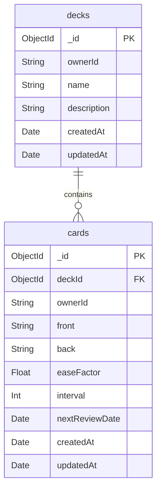
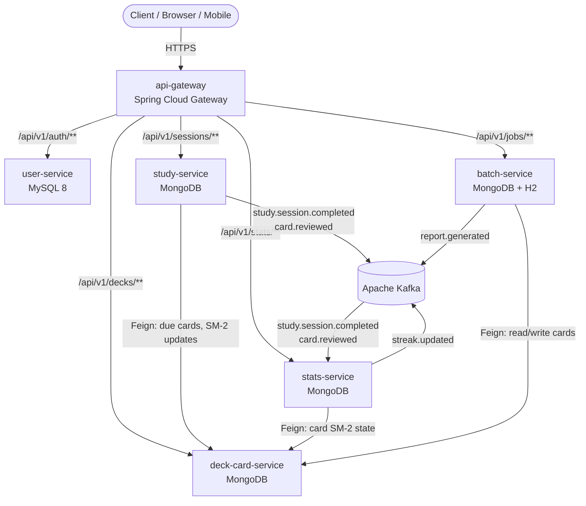
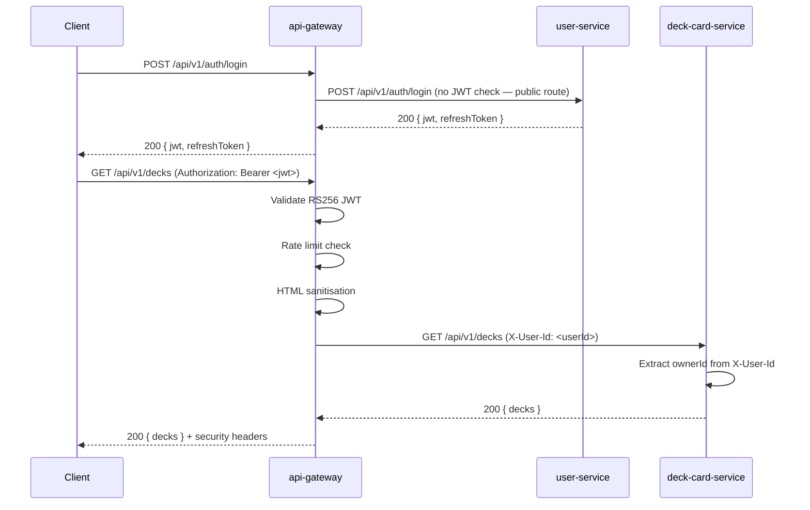
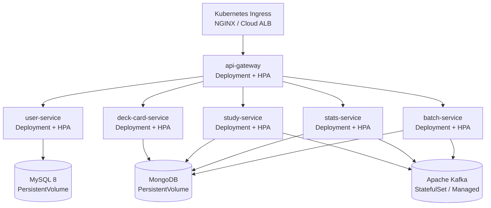

# 3. deck-card-service

**Technology**: Spring Boot 3.3, Java 21, Spring Data MongoDB  
**Exposes (via gateway)**:
- `POST   /api/v1/decks`
- `GET    /api/v1/decks`
- `GET    /api/v1/decks/{deckId}`
- `PATCH  /api/v1/decks/{deckId}`
- `DELETE /api/v1/decks/{deckId}`
- `POST   /api/v1/decks/{deckId}/cards`
- `GET    /api/v1/decks/{deckId}/cards`
- `GET    /api/v1/decks/{deckId}/cards/{cardId}`
- `PATCH  /api/v1/decks/{deckId}/cards/{cardId}`
- `DELETE /api/v1/decks/{deckId}/cards/{cardId}`

**Internal endpoints**:
- `GET   /internal/decks/{deckId}/owner` — returns ownerId for cross-service ownership checks
- `GET   /internal/decks/{deckId}/due-cards` — returns cards where nextReviewDate ≤ today (called by study-service)
- `PATCH /internal/cards/{cardId}/sm2` — updates SM-2 fields on a card (called by study-service)

**Key components**:

| Component | Responsibility |
|---|---|
| `DeckService` | CRUD operations, ownership enforcement, pagination |
| `CardService` | CRUD operations, ownership delegation to DeckService, length validation |
| `OwnershipGuard` | Compares `X-User-Id` header against resource owner; throws `ForbiddenException` on mismatch |


## Data Models



**Indexes**:
- `decks`: `{ ownerId: 1, createdAt: -1 }` (list by owner, sorted)
- `cards`: `{ deckId: 1, createdAt: 1 }` (list by deck, sorted)
- `cards`: `{ deckId: 1, nextReviewDate: 1 }` (due card queries)

## This microservice is one of Flashcard app

## Overview

The Flashcard Service is a production-grade, domain-driven **microservices** system built on Spring Boot 3.3 / Java 21. It enables users to manage flashcard decks, conduct spaced-repetition study sessions, and track learning progress over time. The system is composed of six independently deployable services, each owning its own datastore, communicating via synchronous REST (OpenFeign) and asynchronous Apache Kafka events, and deployed to Kubernetes.

### Design Goals

- **Domain isolation**: each service owns its bounded context and data; no shared databases.
- **Full independence**: each service is a self-contained Maven project with its own `pom.xml`, its own Git repository, and its own CI/CD pipeline. There is no shared library, no common parent POM, and no shared code between services.
- **Correctness by specification**: SM-2 algorithm and all business rules are pure, testable functions.
- **Observable by default**: every service emits structured JSON logs, Prometheus metrics, and OpenTelemetry traces from day one.
- **Secure by default**: JWT RS256 validation and rate limiting at the API gateway; downstream services trust the injected `X-User-Id` header.
- **Cloud-agnostic**: Kubernetes manifests work on AWS EKS, GCP GKE, and Azure AKS without modification.

### No Shared Library Policy

Each of the six services is **fully independent**:

- Each service has its own `pom.xml` with `spring-boot-starter-parent` as its only parent.
- DTOs (e.g. `ApiResponse<T>`), exception classes (`ResourceNotFoundException`, etc.), Feign error decoders, Logback configuration, and MDC filters are **re-implemented inside each service** that needs them. This is intentional — shared libraries create hidden coupling between services and make independent deployability harder.
- Each service lives in its own **Git repository** with its own GitHub Actions workflow.
- Inter-service contracts (the shape of Feign client interfaces and Kafka event payloads) are documented in this design document and kept in sync through **API contract tests** (Spring Cloud Contract, optional) rather than shared code.

---

## Architecture

### High-Level Service Topology



## Observability

All six services implement an identical observability stack:

| Concern | Implementation |
|---|---|
| Structured logging | Logback + `logstash-logback-encoder`; JSON to stdout with fields: `timestamp`, `level`, `traceId`, `spanId`, `userId`, `service`, `message`, `context` |
| Metrics | Micrometer + Prometheus; `/actuator/prometheus` per service |
| Distributed tracing | OpenTelemetry Java Agent; W3C `traceparent` header propagated inbound HTTP → outbound Feign → Kafka headers → DB spans |
| Service identity | `OTEL_SERVICE_NAME` env var set per service |

Trace propagation flow:

```
Client → api-gateway [W3C traceparent]
  → downstream service [X-B3/W3C forwarded by Gateway]
    → Feign call to deck-card-service [traceparent injected by OTel agent]
      → Kafka event [traceId in event payload + Kafka header]
        → consuming service [traceId extracted from header]
```

---

## Security Architecture



Key security decisions:

- **JWT validation is not duplicated** in downstream services. Services trust the `X-User-Id` header injected by the gateway.
- **BCrypt cost 12** used for password storage. Plaintext never stored or logged.
- **Refresh tokens** stored as SHA-256 hashes; plaintext never stored.
- **RS256** enforced at gateway; `alg` claim checked to prevent algorithm confusion attacks.
- **Parameterised queries only** in user-service (JPA/HQL); Spring Data MongoDB typed query objects in all MongoDB services.

---

## Kubernetes Deployment Architecture



Each service Deployment includes:
- `livenessProbe`: `GET /actuator/health/liveness`, initialDelaySeconds: 30, periodSeconds: 10
- `readinessProbe`: `GET /actuator/health/readiness`, initialDelaySeconds: 20, periodSeconds: 5
- `terminationGracePeriodSeconds`: 35 (30s grace + 5s buffer)
- Secrets via `envFrom: secretRef` (DB creds, JWT keypair, Kafka creds)
- ConfigMaps for service URLs, topic names, non-sensitive config

---

## DevSecOps Pipeline

One GitHub Actions workflow **per service Git repository** (each service is independently built and deployed):

```
Trigger: push to main, PR to main (in each service's own repo)
│
├── 1. Compile (mvn compile)
├── 2. Unit Tests (mvn test) + JaCoCo coverage gate ≥ 80%
├── 3. Integration Tests (Testcontainers: MySQL/MongoDB + Kafka)
├── 4. SAST (SpotBugs)
├── 5. Dependency Scan (OWASP Dependency-Check)
├── 6. Secrets Detection (Gitleaks)
├── 7. Docker Build (multi-stage, tag: {git-sha}-{run-number})
├── 8. Container Image Scan (Trivy — fail on CRITICAL/HIGH)
└── 9. Kubernetes Deploy (kubectl apply + rollout status --timeout=120s)
     └── Auto-rollback if readiness/liveness probes fail within 120s
```

Secrets management:
- GitHub Actions encrypted secrets (configured per repo) → injected as env vars at runtime → mounted as Kubernetes Secrets
- Never written to Dockerfile, pipeline YAML, or container layers
- Each service repo configures only the secrets it needs (e.g. user-service needs `JWT_PRIVATE_KEY` and `MYSQL_PASSWORD`; deck-card-service needs only `MONGODB_URI`)

---