# Deck-Card Service — Flow Diagrams

---

## 1. Create Deck

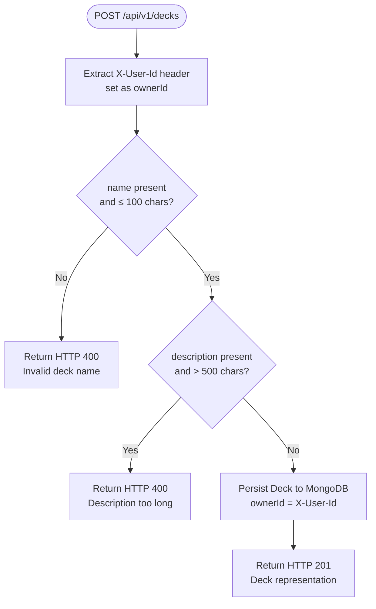

---

## 2. List Decks

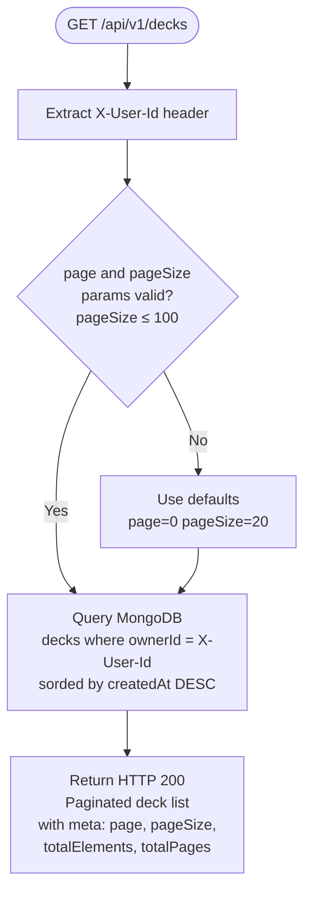

---

## 3. Get Deck by ID

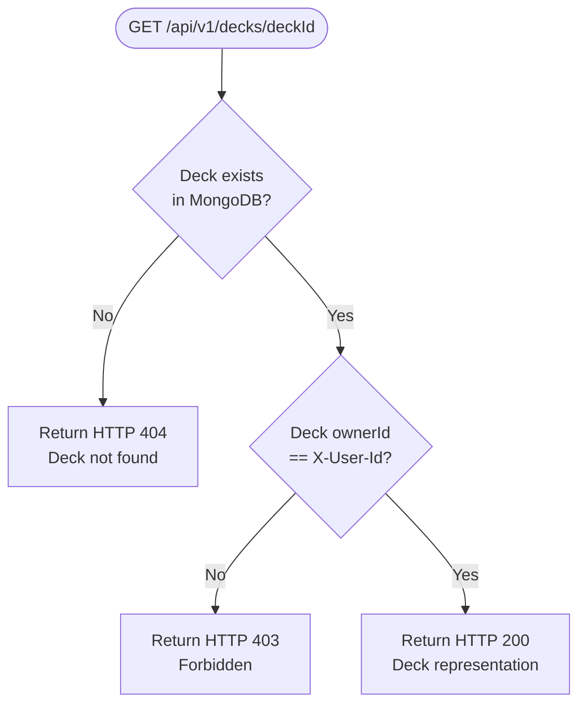

---

## 4. Update Deck

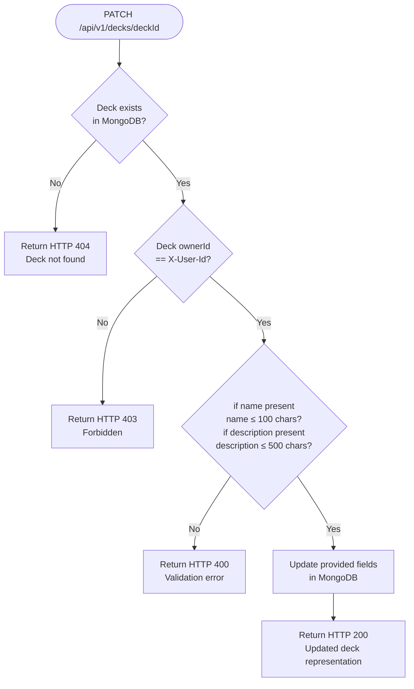

---

## 5. Delete Deck

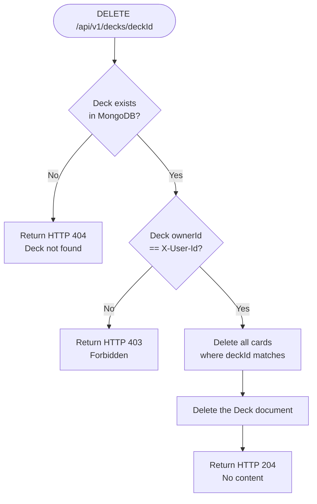

---

## 6. Create Card

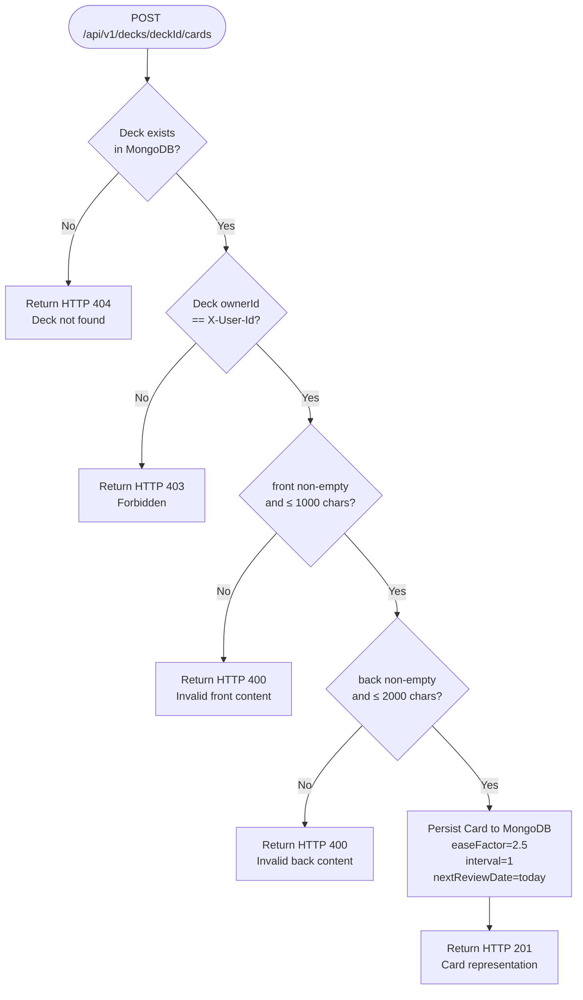

---

## 7. List Cards

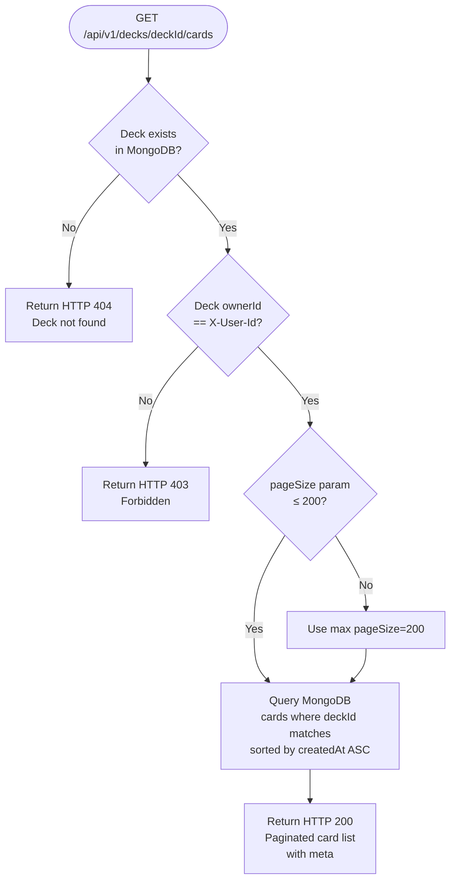

---

## 8. Update Card

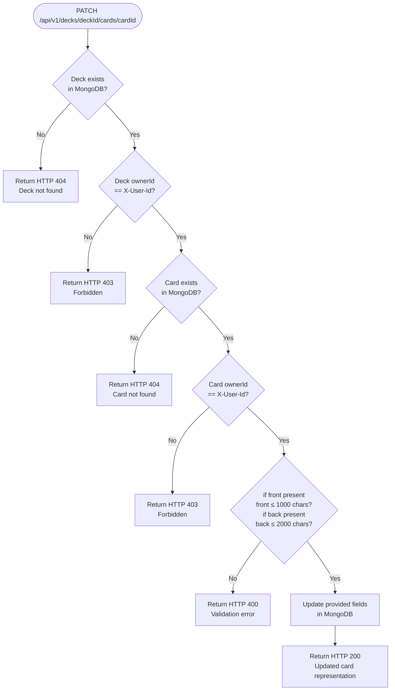

---

## 9. Delete Card

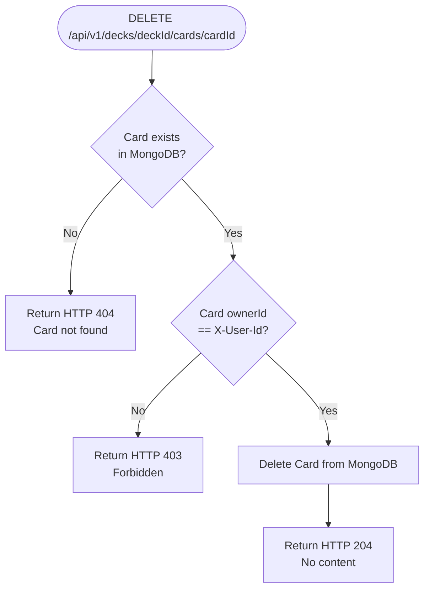

---

## 10. Internal: Get Deck Owner (called by other services)

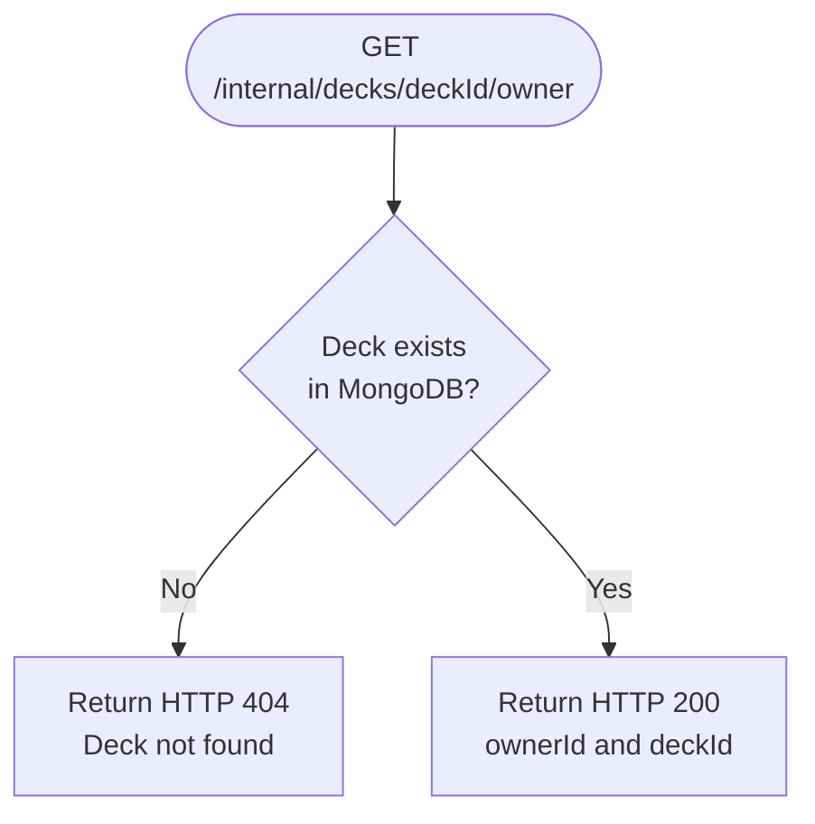

---

## 12. Internal: Get Due Cards (called by study-service)

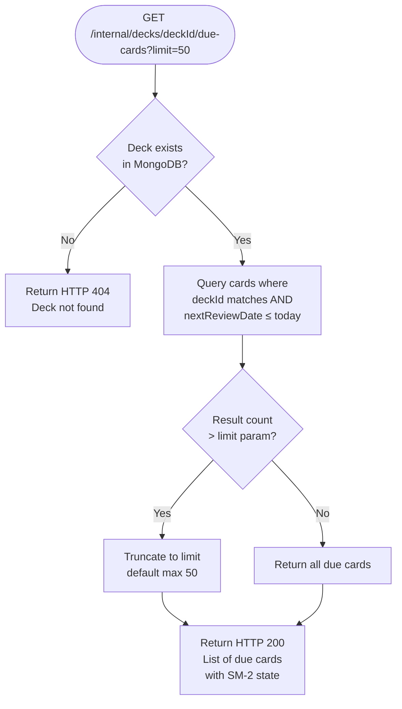

---

## 13. Internal: Update Card SM-2 State (called by study-service)

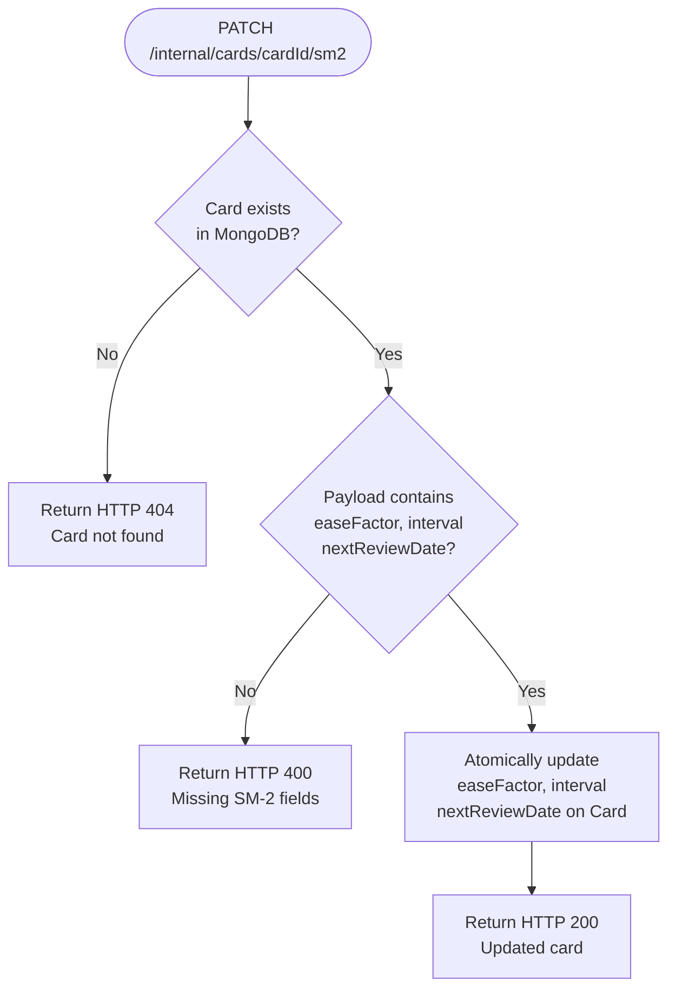
